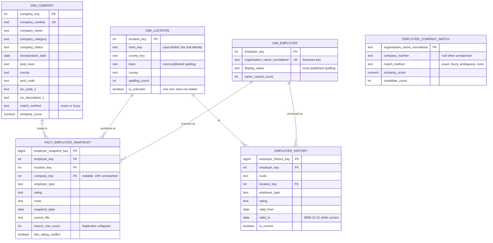

# Entity relationship diagram

The marts layer. Raw and staging tables are deliberately not shown: they are
intermediate working tables, not a model, and including them would obscure the
star.

## Reading the diagram

**`FACT_EMPLOYER_SNAPSHOT` is the centre.** Its grain is one row per employer,
per route, per location, per snapshot, and that grain is enforced by a unique
constraint rather than only described.

**`DIM_COMPANY` is optional** (`|o`). Only 80.66% of employer names matched a
company, so most analysis must survive a null `company_key`. Any query that
inner-joins to `dim_company` is silently answering a question about the matched
subset, which is why the analysis queries say so in their comments.

**`EMPLOYER_COMPANY_MATCH` is not joined to the star.** It is the record of how
matching went, including the names that matched nothing, and it exists so the
match rate can be reported. The star consumes its results through
`dim_company`.

**`EMPLOYER_HISTORY` is the SCD Type 2 table**, keyed on
(employer_key, route, location_key). It currently holds one version per fact
row because only one snapshot has been loaded; a second published snapshot is
what would make it a history.
